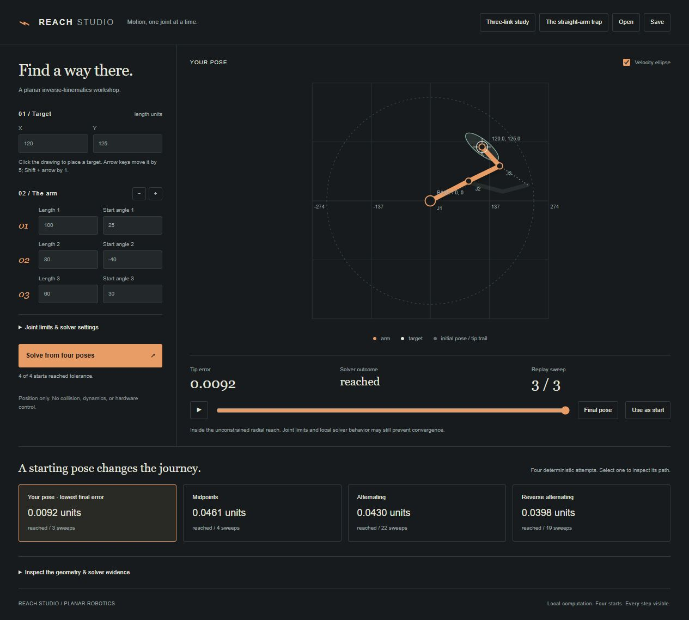
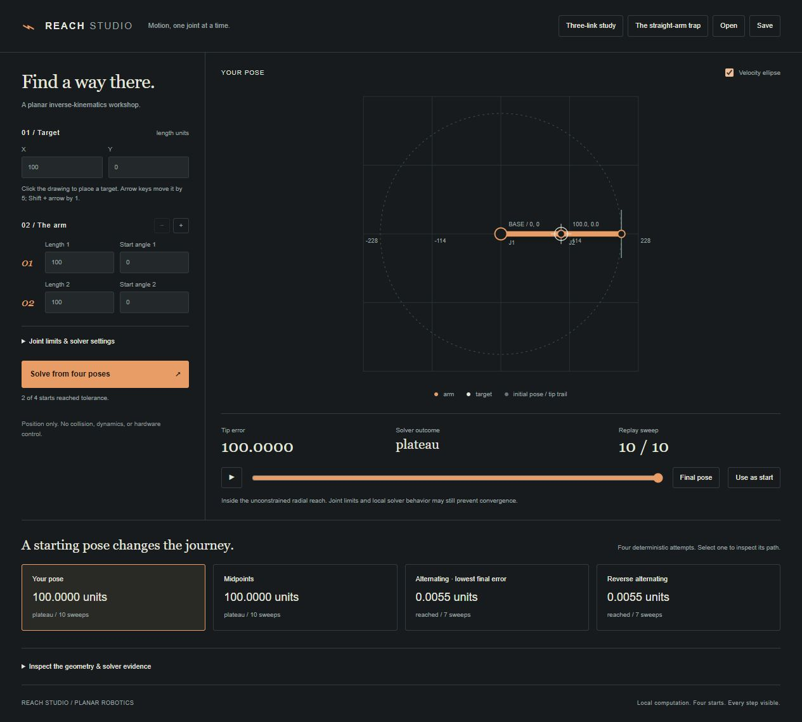

# Reach Studio

A planar robotics workbench for joint-limited inverse kinematics. Place a target, compare four starting poses, replay cyclic coordinate descent, and inspect the position Jacobian and local velocity ellipse. The app distinguishes reaching tolerance, stalling, exhausting the iteration budget, and failing a radial reach bound.



## Run

```sh
python run.py --port 8000
```

Open http://127.0.0.1:8000. Python 3.10+ serves an allowlist of static assets on loopback. A browser module worker performs the calculations; Node 22+ runs the dependency-free tests. No remote API, account, hardware, or package installation is required at runtime.

## Explore

- **Three-link study:** lengths 100, 80, 60; relative starting angles 25°, −40°, 30°; limits ±150°, ±140°, ±120°; target (120,125). All four starts reach the 0.05-unit position tolerance. Your pose reaches it in three sweeps with about 0.0092 units of residual error; the other starts take 4, 22, and 19 sweeps.
- **The straight-arm trap:** two 100-unit links, fully open joint limits, and an inward target at (100,0). Straight and midpoint starts stall with error 100, although alternating starts reach the target within 0.01 units in seven sweeps. A local plateau is not an impossibility proof.
- Click the drawing or use its arrow keys to move the target by five units; Shift + arrow moves one unit. Numeric fields support exact target coordinates.
- Edit lengths and initial angles, add/remove links, and adjust joint limits in the disclosure. Equal minimum/maximum limits lock a joint.
- Select an attempt, scrub or play its sweeps, and **Use as start** to carry an inspected pose into a new study. Playback is an algorithm replay, not a physical trajectory.
- Toggle the velocity ellipse and inspect singular values, condition ratio, area factor, and Jacobian columns at any sweep.
- Save/open study JSON; export every attempt, per-joint update, and snapshot as evidence; export replay CSV or the inspected SVG drawing.

[Default study](docs/example.json) · [Straight-arm study](docs/straight-arm.json)



## Solver contract

The model has a fixed base at (0,0), counterclockwise relative revolute angles in degrees, and rigid positive-length links. Forward kinematics accumulates joint angles, then sums link vectors. It solves tip **position only**, with no requested end orientation.

CCD visits joints from distal to proximal. With other joints fixed, it aligns the pivot-to-tip vector with the pivot-to-target vector, considering equivalent rotations and both endpoints of the allowed angle interval. It chooses a candidate only when it improves distance by more than 10⁻¹² units. This handles angular wrap choices within a closed interval without blindly clipping a single wrapped solution. Degenerate vectors below 10⁻¹² units leave that coordinate unchanged. Each snapshot records a full sweep; the update log retains individual changed joints and before/after errors.

The four deterministic starts are the entered pose, interval midpoints, alternating 25%/75% interval positions, and reverse alternating positions. They are not independent randomized restarts and may coincide. The app initially selects the attempt with the lowest final error, breaking ties by attempt order. It does not optimize sweep count or joint travel.

Termination is explicit: tip error within tolerance, ten consecutive sweeps improving at most 10⁻¹⁰ units, or the sweep budget. Plateau and iteration-limit outcomes do not prove global infeasibility. The unconstrained radial reach is `[max(0, 2*longest−sum), sum]`; targets outside it have an explicit distance lower bound. Inside it, joint limits may still make the target impossible. Boundary comparison uses 10⁻¹⁰ slack.

Bounds: 2–8 links, lengths 5–100, joint limits within −180° to 180°, starts inside limits, target coordinates within ±800, tolerance 0.0001–5 units, 1–500 sweeps, and 50 KB study imports. A sweep recomputes forward kinematics per coordinate, giving O(joints²) work; four starts remain bounded. A worker keeps computation off the UI thread. Draft edits disable exports and stale worker responses cannot overwrite newer input.

## Differential geometry

For joint `i`, the position Jacobian column in radians is `[-(tip.y−pivot.y), tip.x−pivot.x]`. The two singular values derive from the eigenvalues of `J Jᵀ`. A Cauchy–Binet sum of squared 2×2 minors computes its determinant without subtractive cancellation near a straight-arm singularity. The condition ratio is represented as `null` when the minor singular value is at most 10⁻¹² times the major. The area factor is the product of singular values, not the ellipse area including π.

The optional ellipse maps a unit-norm vector of joint rates through J. Its displayed major radius is normalized to 40 SVG units; the ratio and orientation carry the information. At numerical singularity it is drawn as a line. This unconstrained local diagnostic does not account for joint-limit direction restrictions. It is neither a reachable workspace boundary nor a speed prediction.

There is no collision detection, self-collision rejection, obstacle model, acceleration/torque constraint, dynamic simulation, or real-device integration. Links can cross. A converged pose is not a certified safe motion plan.

References: Kris Hauser, [Robotic Systems: Inverse Kinematics](https://motion.cs.illinois.edu/RoboticSystems/InverseKinematics.html); Lynch and Park, [Modern Robotics: Manipulability](https://modernrobotics.northwestern.edu/nu-gm-book-resource/5-4-manipulability/).

## Verification

```sh
npm test
npm run check
python -m unittest discover -s tests -v
```

Seven JavaScript tests cover analytic two-link geometry/Jacobians, singular values, the straight-arm plateau, radial lower bounds, locked joints, iteration limits, invalid inputs, and 300 randomized constrained chains. The randomized checks verify monotone error and Jacobians against independent central finite differences. Recorded coordinate updates also beat a dense independent scan of each allowed angle interval. A Python HTTP test checks static allowlisting, Host rejection, CSP, response lengths, and HEAD semantics.

Browser checks cover pointer/keyboard target movement, replay, starting-pose reuse, link insertion, invalid-limit rejection, unreachable targets, and study round trips. Independent Python calculations reproduced all 52 default snapshots, link geometry, tip errors, Jacobian columns, singular-value identities, and CSV rows. The SVG export was parsed and checked. GitHub Actions runs on Ubuntu with Node 22/24 and Windows with Node 24, with Python 3.13.

`core.js` contains pure geometry and the bounded solver; `worker.js` handles isolated calculation requests; `app.js` handles editing, replay, rendering, and files; `run.py` exposes only the browser assets. No telemetry or uploads are used.
